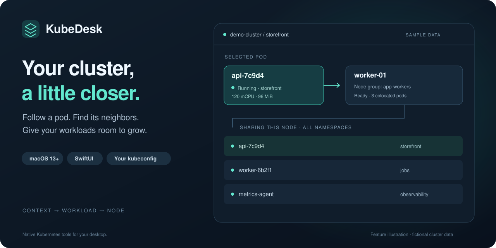
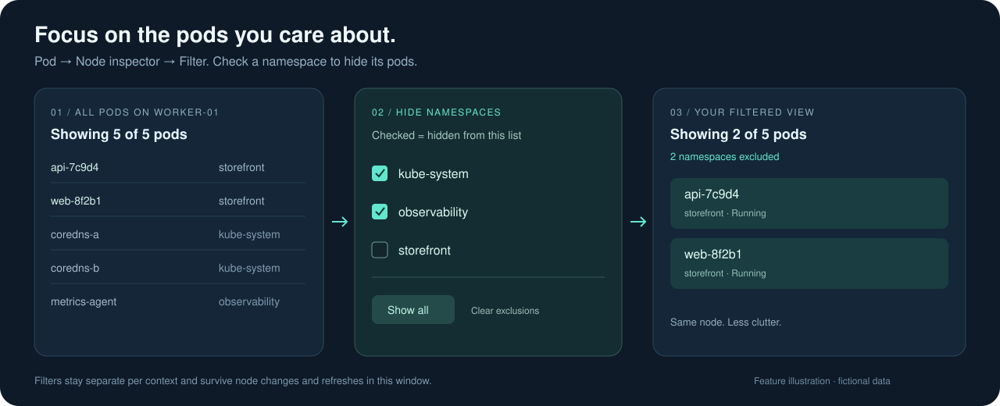
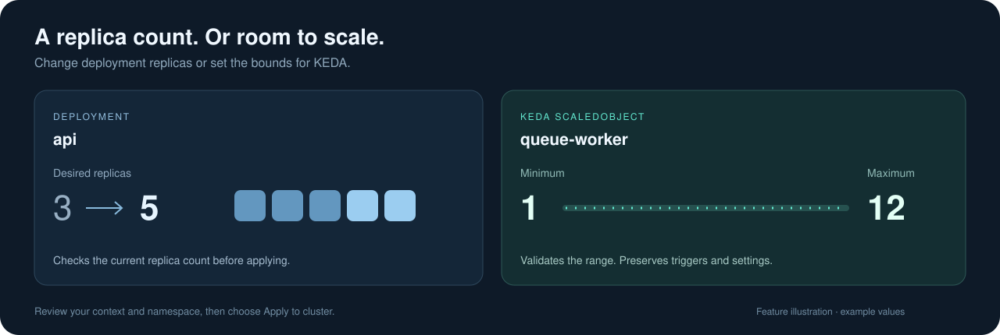

<p align="center">
  
</p>

<h1 align="center">KubeDesk</h1>
<p align="center"><strong>Your Kubernetes cluster, a little closer.</strong><br>
A native macOS app for inspecting workloads, following pod placement, and adjusting scale.</p>
<p align="center">macOS 13+ · SwiftUI · Your existing kubeconfig · No third-party Swift dependencies</p>
<p align="center"><a href="#quick-start">Quick start</a> · <a href="#a-quick-tour">Feature tour</a> · <a href="#connection--permissions">Connection setup</a> · <a href="#troubleshooting">Troubleshooting</a></p>

## Know what's running. See where it lives.

Which context is active? Where did that pod land? What else is sharing its node?

KubeDesk brings those everyday questions into one desktop window. Choose a context and namespace, inspect resource usage, and adjust deployment replicas or KEDA scaling limits without assembling a chain of terminal commands.

| Explore | What you can do |
| :--- | :--- |
| **Contexts & namespaces** | See the active context, switch clusters, and choose or manually enter a namespace. |
| **Pods** | Search by pod or node name. See CPU, memory, status, and the scheduled node. |
| **Node inspector** | Find pods sharing a node across namespaces, then hide namespaces to focus the list. |
| **Nodes & node groups** | Inspect node usage and allocatable capacity, with CPU/memory totals by group. |
| **Deployments** | Compare ready and desired replicas, then apply a new replica count. |
| **KEDA ScaledObjects** | Search by object or target name and edit minimum/maximum replica limits. |

Reads run concurrently, with a 15-second deadline per command. Cancel loading or switch contexts while requests are pending. Refresh manually or enable the optional 30-second refresh.

## Quick start

### 1. Prepare your Mac

You'll need macOS 13 or later, a Swift 5.9+ toolchain (Xcode or compatible Apple Command Line Tools), and `kubectl` configured to access your cluster.

From your terminal, confirm that cluster access works:

```sh
kubectl config current-context
kubectl get pods --namespace default
```

### 2. Build and open

Clone or download this repository, open a terminal in its root directory, and run:

```sh
./scripts/build-app.sh
open dist/KubeDesk.app
```

The script builds a release executable and packages a locally ad-hoc-signed app. You can also open `Package.swift` in Xcode for development. The generated app is not notarized for distribution; build it on the Mac where you'll run it.

### 3. Pick your context

Choose a context and namespace in the sidebar. If `kubectl` isn't found, open **KubeDesk → Settings** (`⌘,`) and set its absolute path. The default is `/opt/homebrew/bin/kubectl`.

> **Context switching also affects your terminal.** Selecting a context runs `kubectl config use-context`, updating the current context in your kubeconfig.

## A quick tour

### Follow a pod to its neighbors

1. Open **Pods** and search for a workload.
2. Select its row to open the **Node inspector**.
3. See the pods sharing that node, including workloads outside your selected namespace.

You can also open the inspector from **Nodes**. Pending pods without an assigned node have no placement to inspect.

### Filter out the namespaces you don't need



*Feature illustration with fictional data, not an app screenshot.*

1. Select a pod to open its **Node inspector**, then choose **Filter**.
2. Check namespaces to **hide** them—for example, `kube-system` or `observability`.
3. The list updates immediately, with **Showing X of Y pods** so you can see how much is hidden.
4. Uncheck a namespace to bring it back, or choose **Show all** to clear every exclusion.

Filters apply only to the node inspector; the main Pods list is unaffected. Selections stay separate for each context and survive node changes and refreshes in the same window. They reset when the app is reopened. Changing the filter uses the already-loaded pod list without another cluster request.

If the filter hides every pod, the inspector explains why and offers **Show all namespaces** to restore the list.

### Give workloads room to grow



*The visuals in this README are feature illustrations, not screenshots. All names and values are fictional.*

- **Deployments → Scale…** sets the desired replica count. Review the context and namespace, then choose **Apply to cluster**. The update checks the previous replica count to catch concurrent changes.
- **ScaledObjects → Edit limits…** changes KEDA's minimum and maximum replicas. The editor validates the range, accounts for configured idle replicas, and preserves triggers and other settings. A resource-version check rejects stale edits.

KEDA's omitted limits appear as defaults: **0 minimum / 100 maximum**. A deployment set to zero stops its pods; a KEDA minimum of zero permits scale-to-zero when triggers are inactive. Autoscalers can override manual deployment replica changes.

### See usage by node group

The **Nodes** view detects these labels automatically:

| Provider | Node-group label |
| :--- | :--- |
| Amazon EKS | `eks.amazonaws.com/nodegroup` |
| Google GKE | `cloud.google.com/gke-nodepool` |
| Azure AKS | `kubernetes.azure.com/agentpool` |
| Karpenter | `karpenter.sh/nodepool` |
| Fallback | `agentpool` |

Set a custom label in **Settings** to override detection. Unmatched nodes appear under **Ungrouped**.

CPU is shown in millicores and memory in MiB. Node usage is compared with allocatable capacity. Values are current metrics snapshots, not historical charts; `—` means unavailable, never zero. Group totals are unavailable if any member is missing metrics.

## Connection & permissions

KubeDesk uses your installed `kubectl` and its normal kubeconfig resolution: inherited `KUBECONFIG`, otherwise `~/.kube/config`. Authentication stays with kubectl and your configured credential helpers.

Finder-launched apps don't inherit your terminal's shell configuration. To use a custom kubeconfig, launch from your configured terminal:

```sh
KUBECONFIG=/absolute/path/config \
  dist/KubeDesk.app/Contents/MacOS/KubeDesk
```

Homebrew executable directories are added to the subprocess PATH. Custom authentication helpers must be on that PATH or configured with absolute paths.

| Feature | Cluster access needed |
| :--- | :--- |
| Namespace picker | List namespaces; manual entry works without this permission. |
| Workload lists | List pods and deployments in the selected namespace. |
| Nodes | List nodes. |
| Node inspector | List pods across namespaces. |
| CPU & memory | Access to pod/node resources in `metrics.k8s.io`, usually provided by Metrics Server. |
| Deployment scaling | Read deployments and update/patch `deployments/scale`. |
| ScaledObject editing | KEDA installed; list and patch `scaledobjects` in the `keda.sh` API group. |

Resource and metrics failures are reported separately. Missing KEDA or ScaledObject permissions don't block the other workload views.

## Troubleshooting

| Symptom | What to check |
| :--- | :--- |
| `kubectl` not found | Set the correct absolute executable path in **Settings**. |
| Loading times out | Check VPN, DNS, cluster connectivity, and cloud authentication. Cancel or switch contexts to continue. |
| CPU/memory shows `—` | Check Metrics Server availability and metrics permissions. |
| Node inspector can't list pods | Your account needs permission to list pods across namespaces. |
| No ScaledObjects available | Check the namespace, KEDA installation, and access to `scaledobjects.keda.sh`. |
| An update conflicts | Refresh and reopen the editor; the resource changed after it was loaded. |
| A write times out | Refresh to check whether the change reached the cluster before retrying. |

## Development

Run the standalone checks with Apple Command Line Tools:

```sh
./scripts/test.sh
```

With full Xcode installed, you can also run the XCTest suite:

```sh
swift test
```

Checks cover quantity parsing, pod placement, node grouping, metrics aggregation, command timeouts and cancellation, context switching, and ScaledObject validation and patching. Cluster behavior is tested with a fake kubectl; the automated checks don't modify live clusters.

```text
Sources/KubeDesk/
  App.swift          SwiftUI views and editors
  Store.swift        Loading, selection, and cluster actions
  Kubernetes.swift   kubectl runner and resource models
Tests/               Core checks and loading regressions
scripts/             Build and test entry points
docs/images/         Self-contained README illustrations
```

Build output lives in `.build/` and `dist/`; both are excluded from Git. Before sharing screenshots or release artifacts, check them for cluster details and local build paths.

---

Built around [kubectl](https://kubernetes.io/docs/reference/kubectl/) and the [KEDA ScaledObject specification](https://keda.sh/docs/2.21/reference/scaledobject-spec/).
